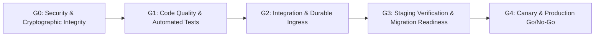
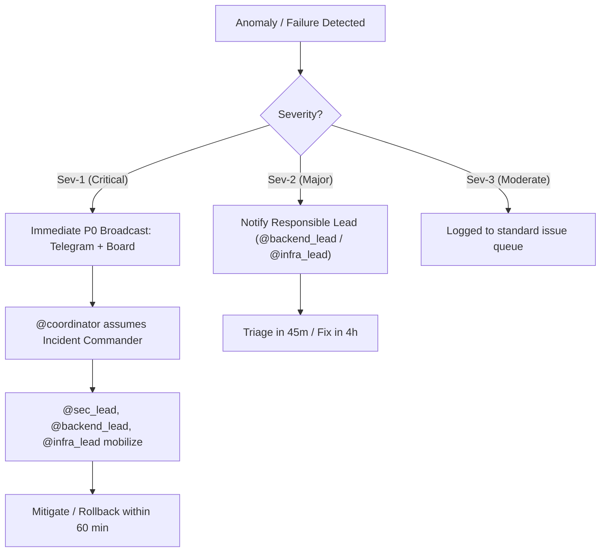

# ERPLink Software Engineering Co.
## Pre-Launch Live Readiness Taskforce: Department Organizational Charter & Operating Framework

**Document Version:** 1.0.0  
**Effective Date:** 2026-11-23  
**Status:** Approved for Taskforce Execution  
**Target System:** ERPLink Enterprise Bridge (Zid / Salla / Shopify ↔ Odoo / ERPNext Integration Suite)

---

## 1. Executive Summary & Purpose

ERPLink is entering its pre-launch live readiness phase. Because ERPLink orchestrates multi-tenant transactional workflows (e-commerce orders, customer data, inventory reconciliations, financial journals, return operations, and webhooks) between retail platforms and enterprise ERPs, reliability, data durability, tenant isolation, and cryptographic integrity are paramount.

This charter establishes the organizational structure, roles, responsibilities, operating rhythms, verification SLAs, launch readiness gates, escalation rules, and mandatory sign-off checklists governing all engineering and release decisions.

---

## 2. Core Operational Principles

1. **Zero Data Loss Guarantee:** No webhook or event may ever be dropped or acknowledged with HTTP 200 before being durably persisted in Supabase.
2. **Strict Multi-Tenant Isolation:** All queries, mapping lookups, credential decryptions, and ERP sync dispatches must be strictly scoped to `workspace_id`. Cross-tenant credential or mapping inheritance is forbidden.
3. **Cryptographic Integrity at Rest & in Transit:** AES-GCM v2 authenticated encryption with HKDF-derived ingress credentials; zero hardcoded secrets; mandatory TLS/HTTPS on all external endpoints.
4. **Deterministic Auditing:** Every ingress event, skip, manual resolution, and ERP write leaves an immutable audit trail in `sync_logs` / `audit_logs`.
5. **No Single Point of Human Failure:** Every production change requires peer review, automated CI gate passage, and explicit multi-lead sign-off.

---

## 3. Organizational Roles & RACI Matrix

### 3.1 Taskforce Roles & Ownership

| Role | Lead Handle | Primary Mandate & Core Responsibilities |
|---|---|---|
| **CTO / General Manager** | `@coordinator` | Final release authority, commercial risk ownership, cross-discipline escalation arbiter, incident commander for critical Sev-1 events. |
| **Cybersecurity & Compliance Lead** | `@sec_lead` | Encryption at rest (AES-GCM v2, key rotation), webhook ingress authentication (Zid Basic rekey v2, Salla HMAC/derived headers, Odoo scoped tokens), Clerk Authz guards, RLS compliance, dependency CVE audits. |
| **QA & Test Automation Lead** | `@qa_lead` | Test automation coverage (Jest suites, regression pins, CI gates), end-to-end integration testing across store-ERP combinations, data integrity verification (returns, taxes, line items), load and admission testing. |
| **Backend & ERP Integrations Lead** | `@backend_lead` | Queue admission & batch processing, idempotent sync execution, Odoo/ERPNext XML-RPC / JSON-RPC connectors, platform event routing (Zid, Salla, Shopify), return interception, manual billing & subscription services. |
| **DevOps & SRE Infrastructure Lead** | `@infra_lead` | Hostinger Node.js server lifecycle, Next.js 15 deployment reliability, Supabase connection pooling & query optimization, queue self-runner & cron schedulers (`CRON_SECRET`), Telegram outbox monitoring, backup and rollback automation. |
| **HR & Operations Lead** | `@hr_lead` | Operational rhythms, task allocation, SLA compliance tracking, cross-functional communication governance, escalation tracking, post-mortem reviews, team workload and readiness tracking. |

### 3.2 RACI Matrix Across Key Lifecycles

*R = Responsible (Executes), A = Accountable (Final Approver), C = Consulted (Provides Input), I = Informed (Kept Updated)*

| Task / Lifecycle Activity | `@coordinator` | `@sec_lead` | `@qa_lead` | `@backend_lead` | `@infra_lead` | `@hr_lead` |
|---|:---:|:---:|:---:|:---:|:---:|:---:|
| **Architecture & Schema Evolution** | **A** | **C** | **C** | **R** | **C** | **I** |
| **Ingress Security & Auth Rekeying** | **A** | **R** | **C** | **C** | **C** | **I** |
| **Test Suite Maintenance & Regression Pins** | **I** | **C** | **R** | **C** | **I** | **I** |
| **ERP Connector & Sync Business Logic** | **A** | **C** | **C** | **R** | **I** | **I** |
| **Queue Performance & Hostinger Deployments**| **A** | **I** | **C** | **C** | **R** | **I** |
| **Launch Readiness Gate Evaluations** | **A** | **R** | **R** | **R** | **R** | **R** |
| **Sev-1 Production Incidents & Rollback** | **A** | **C** | **C** | **R** | **R** | **C** |
| **Operational Governance & SLA Tracking** | **I** | **I** | **I** | **I** | **I** | **R** |

---

## 4. Swarm Communication Protocols & Review Cadence

### 4.1 Swarm Board Etiquette & Addressing Standards

1. **Targeted Wakeups Only (`@name`):** Always address the specific peer required to act. Do not tag uninvolved roles or `@coordinator` on routine intermediate handoffs.
2. **`@all` Reserved for Hard Halts:** Use `@all` strictly for company-wide blockers, emergency production halts, or breaking architectural changes.
3. **No Acknowledgment Clutter:** Never post empty greetings, "received", or "working on it". Post only when claiming unassigned work, asking a critical blocking question, or delivering verified results.
4. **Completion Standard (`[done]`):** Final deliverables must begin with `[done]` after the recipient mention (e.g., `@coordinator [done] 
`).
5. **Reference Traceability:** Refer to earlier board posts by sequence ID (`#seq`) rather than copying raw text.

### 4.2 Review Cadence & Operational Milestones

| Event | Cadence | Participants | Focus & Deliverable |
|---|---|---|---|
| **Asynchronous Standup** | Daily by 09:00 UTC | All Taskforce Leads | 3 points: What landed yesterday, what is committing today, active blockers. |
| **Readiness Gate Sync (G0 - G4)** | Milestone Driven (T-72h, T-24h, T-2h) | All Taskforce Leads | Review checklist verification, sign-off matrix sign-offs, Go/No-Go decision. |
| **Post-Release Hypercare Window** | Continuous T0 to T+48h | Infra, Backend, Sec, QA | Monitor queue backlog, Telegram alerts, error logs, retry rates, and DB latency. |
| **Blameless Post-Mortem** | Within 48h of any Sev-1/2 | Taskforce Leads & CTO | Root cause analysis (RCA), timeline, preventive action items, test coverage gaps. |

---

## 5. Cross-Functional Verification SLAs

### 5.1 Code & Specification Review SLA

| Severity / Priority | Target Review Time | Maximum Approval Turnaround | Criteria |
|---|---|---|---|
| **P0 (Emergency / Hotfix)** | < 15 minutes | 30 minutes | Live outage, active data loss, security exposure. |
| **P1 (Launch Readiness Blocker)** | < 1 hour | 2 hours | Test failure, gate failure, broken integration. |
| **P2 (Standard Feature / Improvement)** | < 4 hours | 6 hours | Normal planned changes, non-blocking docs/tests. |

### 5.2 Incident Triage & Resolution SLA

| Incident Level | Acknowledgment SLA | Triage SLA | Mitigation / Fix SLA | Escalation Target |
|---|---|---|---|---|
| **Sev-1 (Critical)** Data loss, tenant breach, sync halt across all stores, unauthenticated webhook exploit | **< 5 minutes** | **< 15 minutes** | **< 60 minutes** | Immediate call, notify `@coordinator`, page `@infra_lead`, `@sec_lead`, `@backend_lead` |
| **Sev-2 (Major)** Single connector failure (e.g. Salla returns failing), queue latency > 10 min, auth rekey stalling | **< 15 minutes** | **< 45 minutes** | **< 4 hours** | Notify `@backend_lead` & `@infra_lead`, alert `@coordinator` |
| **Sev-3 (Moderate)** Isolated non-blocking mapping glitch, transient Telegram rate limit, localized admin UI bug | **< 1 hour** | **< 4 hours** | **< 24 hours** | Handled in normal queue by domain lead |

### 5.3 Automated Verification SLA

- **Local & Pre-Merge CI Run (Type Check + Lint + Jest Suites + Production Build):** Must pass in **< 8 minutes**. Any flaky test must be quarantined or fixed immediately; CI bypasses are forbidden.

---

## 6. Launch Readiness Gates (Phase Gates G0 - G4)

Before ERPLink code is cleared for live production release, it must sequentially satisfy five progressive gates:

### Gate 0: Security & Cryptographic Integrity (Owner: `@sec_lead`)
- [ ] Production `ENCRYPTION_KEY` configured; AES-GCM v2 verified; legacy CBC keys decrypt-only.
- [ ] No plaintext API keys or credentials committed to repository or in `NEXT_PUBLIC_*`.
- [ ] Ingress authentication enforced:
  - Zid: Basic auth derived via HKDF (`merchant_tokens` v2 verified).
  - Salla: Dual-path HMAC signature & derived header verified.
  - Odoo: Scoped tokens (`stock:<workspace>` / `record:<mapping>`) active.
- [ ] Clerk authorization guard and multi-tenant RLS policies verified against cross-tenant access.
- [ ] Dependency security scan shows 0 Critical / 0 exploitable High vulnerabilities.

### Gate 1: Code Quality & Automated Test Pass (Owner: `@qa_lead`)
- [ ] `npm run type-check`: 0 TypeScript errors.
- [ ] `npm run lint`: 0 ESLint errors.
- [ ] `npm test`: 100% of unit & regression suites passing (all 56+ suites / 879+ tests).
- [ ] Regression pins intact (no-loss regressions, workspace scoping, analytic distribution, return detection).
- [ ] `npm run build`: Production Next.js build compiles without warnings or errors.

### Gate 2: Integration & Durable Ingress (Owner: `@backend_lead`)
- [ ] No 200 OK sent to webhooks prior to durable DB write in Supabase.
- [ ] Ingress rate limiting verified: certified webhooks admitted; spam/unauthorized IPs dropped.
- [ ] Queue deduplication (`fingerprintPayload`, entity identity extraction) active.
- [ ] Return interception operational: credit notes and stock returns correctly identified.
- [ ] Sync log fidelity: lean list queries optimized (no full payload in list view); detailed log view retains full payload & trace.

### Gate 3: Staging Verification & Migration Readiness (Owner: `@infra_lead`)
- [ ] Supabase migrations applied and validated with rollback scripts prepared.
- [ ] Node.js Hostinger environment configured (`SYNC_QUEUE_SELF_RUNNER=true`, HTTPS external endpoints).
- [ ] Cron schedulers updated with `Authorization: Bearer <CRON_SECRET>`.
- [ ] Telegram outbox alert pipeline connected and responsive.
- [ ] Backup snapshot of database and configurations taken within 60 minutes of release window.

### Gate 4: Production Canary & Final Release Sign-Off (Owner: `@coordinator`)
- [ ] All prerequisite gates (G0–G3) marked complete with lead sign-offs.
- [ ] 3 test store migrations validated (Zid webhook auth version = 2).
- [ ] Hypercare on-call roster staffed for the initial 48-hour window.
- [ ] Rollback criteria agreed upon and documented.

---

## 7. Escalation Matrix & Incident Protocol

### Escalation Path Table

| Tier | Role | Trigger / Escalation Condition | Response Action |
|---|---|---|---|
| **Level 1** | Primary Domain Lead (`@backend_lead`, `@infra_lead`, `@sec_lead`, or `@qa_lead`) | Any alert or bug matching domain; P1/P2 failures. | Direct triage, diagnostic analysis, PR creation for hotfix. |
| **Level 2** | Cross-Functional Lead Consultation (`@sec_lead` + `@backend_lead` + `@infra_lead`) | Bug spans ingress auth, queue durability, or DB performance; triage exceeds 30m without root cause. | Joint troubleshooting session, live log inspection. |
| **Level 3** | Executive Escallation (`@coordinator`) | Sev-1 incident, data loss risk, rollback decision required, or SLA breach. | Halts ingress/release, executes rollback protocol, notifies stakeholders. |

---

## 8. Pre-Launch Production Release Sign-Off Checklist

Before cutting a release tag or deploying to live production, every lead must execute and sign off on their mandatory verification items:

| Discipline | Verification Item | Status | Verified By |
|---|---|:---:|:---:|
| **Security** | Secrets at rest encrypted with AES-GCM v2 (`ENCRYPTION_KEY` verified) | [ ] | `@sec_lead` |
| **Security** | Webhook ingress authenticated (Zid v2 Basic, Salla HMAC/header, Odoo scope) | [ ] | `@sec_lead` |
| **Security** | HTTPS enforced on all ERP endpoints (HTTP strictly refused) | [ ] | `@sec_lead` |
| **QA** | Full test suite clean pass (type-check, lint, test, build) | [ ] | `@qa_lead` |
| **QA** | Regression pins and cross-tenant workspace scoping verified | [ ] | `@qa_lead` |
| **QA** | Standard mapping and return handling verified against test payloads | [ ] | `@qa_lead` |
| **Backend** | Ingress admission and durable persistence verified before 200 OK | [ ] | `@backend_lead` |
| **Backend** | Queue batcher and retry budget handling active | [ ] | `@backend_lead` |
| **Backend** | Audit log trail verified for sync events and administrative actions | [ ] | `@backend_lead` |
| **Infra** | Hostinger production environment variables and Node.js runtime ready | [ ] | `@infra_lead` |
| **Infra** | Cron schedulers using `Bearer <CRON_SECRET>` verified | [ ] | `@infra_lead` |
| **Infra** | Supabase database backup verified and rollback procedure tested | [ ] | `@infra_lead` |
| **Infra** | Telegram alert outbox active and reporting queue health | [ ] | `@infra_lead` |
| **HR / Ops** | Shift roster, on-call hypercare schedule, and SLA tracking active | [ ] | `@hr_lead` |
| **Executive** | **FINAL GO / NO-GO SIGN-OFF FOR LIVE LAUNCH** | [ ] | `@coordinator` |

---

*Authored by:* **HR & Operations Lead (`@hr_lead`)**  
*Presented to:* **CTO / General Manager (`@coordinator`)**  
*File Reference:* `docs/operations/team-charter-and-readiness-framework.md`
